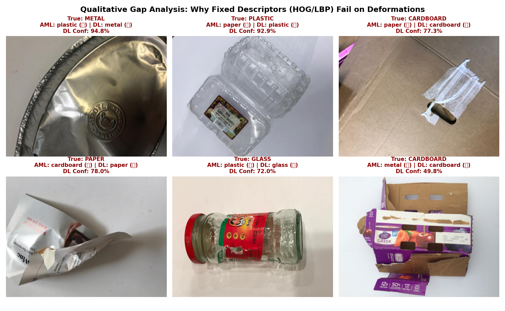

# Everyday Waste Sorting via Manual Image Descriptors vs. Transfer Learning
### Smart Waste Segregation Assistant (Project 12)

[](https://www.python.org/downloads/)
[](https://pytorch.org/)
[](https://gradio.app/)
[](LICENSE)

An educational machine learning prototype investigating the transition from **Classical Applied ML (fixed hand-crafted descriptors)** to **Modern Deep Transfer Learning (reusable convolutional representations)** on the 6-class **TrashNet** dataset (*cardboard, glass, metal, paper, plastic, trash*).

---

## 🎯 Project Overview & 'Hybrid' Logic

1. **Applied ML (AML) Baseline:** We extract 1,634 hand-crafted visual features combining:
   - **HSV Color Histograms** (material chromaticity and tone)
   - **HOG (Histogram of Oriented Gradients)** (structural contours and silhouettes)
   - **LBP (Local Binary Patterns)** (micro-surface textures)
   - Classifiers: Support Vector Machine (RBF kernel) & Random Forest with balanced class weights.
2. **Deep Learning (DL) Transfer Learning:** We utilize **MobileNetV2** pre-trained on ImageNet as a frozen feature extractor with a custom classification head (Global Average Pooling $\rightarrow$ Dropout $\rightarrow$ Linear) trained with conservative augmentations and class-weighted cross-entropy.
3. **The 'Gap':** Demonstrating why manual descriptors break down under lighting changes and object deformations (crushed cans, crumpled plastic), while hierarchical convolutional representations generalize effectively.
4. **Safety & Abstain Response:** Incorporating an uncertainty filter ($\tau = 0.60$) that abstains when confidence is low to prevent catastrophic recycling batch contamination.
5. **Educational Disclaimer:** Visual material identity $\neq$ real disposal instructions. Local municipal infrastructure and organic food contamination govern actual recyclability.

---

## 📊 Benchmark Results (Held-Out Test Set: 378 Images)

| Model Architecture | Accuracy | Macro F1 | Calibration (ECE) | With Abstain Filter ($\tau = 0.60$) |
|:---|:---:|:---:|:---:|:---:|
| **AML: SVM (RBF)** | **73.28%** | **0.7199** | **0.0590** | 73.28% $\rightarrow$ **89.27%** |
| **AML: Random Forest** | **74.87%** | **0.7405** | **0.3168** | — |
| **DL: MobileNetV2** | **84.39%** | **0.8268** | **0.1038** | 84.39% $\rightarrow$ **94.60%** |

### Per-Class Recall Highlights:
* **Metal:** AML 75.4% $\rightarrow$ MobileNetV2 **93.44%** *(+18% recall boost on deformed aluminum cans)*
* **Plastic:** AML 65.3% $\rightarrow$ MobileNetV2 **81.94%** *(+16.6% recall boost on crushed bottles and translucent containers)*
* **Cardboard:** AML 72.1% $\rightarrow$ MobileNetV2 **88.52%**
* **Trash:** AML 60.0% $\rightarrow$ MobileNetV2 **70.00%** *(balanced loss significantly improves this underrepresented class)*

---

## 🔬 Qualitative Failure Case Study



*Fixed descriptors (HOG/LBP) easily confuse deformed metal lids and clear plastic with paper due to surface print and bent shapes. MobileNetV2 learns spatial hierarchies invariant to these deformations.*

---

## 🚀 Quickstart & Local Installation

### 1. Clone & Install Dependencies
```bash
git clone https://github.com/ishyverma/T041-AML-DL-Project.git
cd T041-AML-DL-Project
pip install -r requirements.txt
```

### 2. Launch the Interactive Web Prototype
```bash
python app.py
```
Open **[http://127.0.0.1:7860](http://127.0.0.1:7860)** in your browser to test dual inference, confidence meters, and the abstain alert on pre-loaded samples or uploaded photos.

---

## 🌐 Deploying to Hugging Face Spaces (Free Cloud Hosting)

This repository is ready for one-click free hosting on **Hugging Face Spaces**:
1. Go to [huggingface.co/new-space](https://huggingface.co/new-space).
2. Select **Gradio** as the Space SDK and choose **Public** (Free CPU Tier).
3. Push this repository to your Hugging Face Space:
   ```bash
   git remote add space https://huggingface.co/spaces/<YOUR_USERNAME>/<SPACE_NAME>
   git push space main
   ```
4. Hugging Face will automatically detect `app.py` and `requirements.txt` and run the app 24/7!

---

## 📚 References
1. **Gary Thung and Mindy Yang (2016)**. *Classification of Trash for Recyclability Status*. Stanford University CS229.
2. **Mark Sandler, Andrew Howard, Menglong Zhu, Andrey Zhmoginov, Liang-Chieh Chen (2018)**. *MobileNetV2: Inverted Residuals and Linear Bottlenecks*. CVPR 2018.
